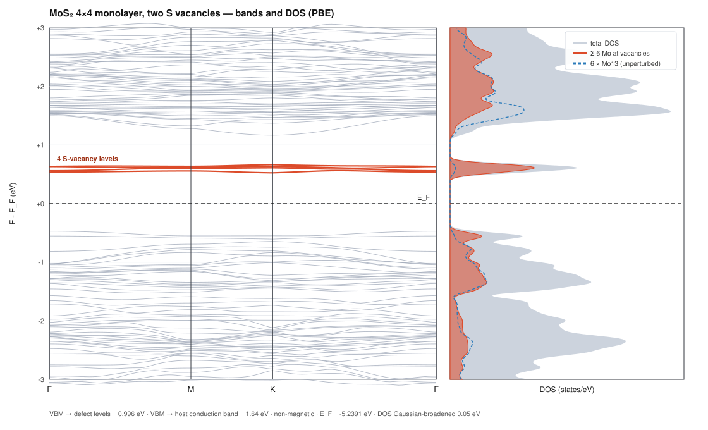

# MoS2 sulfur vacancy (OpenMX)

DFT study of a 4x4 monolayer MoS2 supercell with two sulfur vacancies, run in
OpenMX 4.0. Structure relaxation, band structure, tetrahedron DOS/PDOS, Fermi
surface, and effective masses from 2D k-grid fits.



Band structure (G-M-K-G) and DOS around the gap. Red = the four defect levels
from the two vacancies, sitting inside the host gap. Dashed blue is the PDOS
of a Mo atom far from either vacancy (x6), just as an unperturbed reference.

## the system

4x4 supercell of monolayer 2H-MoS2, a = b = 12.7613 A, gamma = 120 deg, 15 A
vacuum along c. 46 atoms: 16 Mo, 30 S (stoichiometric would be 32 S). Two S
vacancies, one per S sublayer, 6.32 A apart (3.19 A in-plane, 3.12 A across
the layer). Started from the CIF (`test_1.cif`, Materials Studio, P1) with
those two S atoms deleted and coordinates converted to Cartesian.

## method

OpenMX 4.0, GGA-PBE, spin-polarized. Basis Mo7.0-s3p2d2 / S7.0-s2p2d1f1,
PBE19 norm-conserving pseudopotentials (DFT_DATA19 set). 200 Ry real-space
grid cutoff, 6x6x1 k-mesh, electronic temperature 789.5 K, RMM-DIIS(k)
mixing. Geometry relaxed with BFGS, force criterion 5e-4 Ha/Bohr.

## layout

Four directories, roughly in the order I ran them:

- root (`input.dat`, `test_1.*`) - relaxation + ground state SCF
- `fine_k/` - 1D band scan across the (displaced) supercell K point, to
  actually find where the conduction band minimum sits
- `props/` - full G-M-K-G band structure, tetrahedron DOS/PDOS, Fermi
  surfaces, plus the two scripts that produce the figure above and the
  effective-mass PDF
- `mesh2d/` - 21x21 2D k-grids at both band extrema, used for the mass
  tensor fits

Every subfolder's `input.dat` restarts from the relaxed density
(`scf.restart on`), so the SCF block has to match the root run exactly or
the restart just reads garbage.

Not committed: the `.cube` volumetric files, the `*_rst/` restart folders,
and the raw DOS eigenvector dump (`test_1.Dos.vec`, ~200 MB by itself).
All regenerable from the inputs here, all huge for what they're worth in
git. See "running it yourself" below.

## results

Final total energy -1437.50566 Ha. Relaxation converged around MD step 23,
|F|max 3.2e-4 Ha/Bohr. Spin-polarized calculation but comes out non-magnetic
- Mulliken up/down populations both 202.0, net moment zero. Neither the C3
rotation nor the mirror plane of the pristine lattice survives relaxation.

Energies below relative to E_F = -5.239 eV (OpenMX's internal scale, not
vacuum-aligned). VBM sits at Gamma, -0.471 eV, 79 meV of dispersion - this
is the primitive-cell K point folded back by the 4x4 supercell. The four
defect levels from the vacancies sit at +0.525 to +0.663 eV (138 meV
spread). Host conduction band edge is at +1.167 eV, but its minimum isn't
quite at the supercell K point (K_sc) - it's shifted about 0.003 Bohr^-1
off K_sc along Gamma-K, because the two vacancies break the 3-fold symmetry
that would otherwise pin it there. `fine_k/` exists specifically to locate
that shifted minimum before the mass fits in `mesh2d/`.

VBM to lowest defect level: 0.996 eV. VBM to host CB: 1.638 eV.

### effective masses

From the 2D grids in `mesh2d/` (882 k-points, +/-0.008 Bohr^-1, spacing
8e-4), fit to E = E0 + p.k + (1/2) k.H.k and diagonalized:

| carrier | band | where | m1 | m2 | m_DOS | axis |
|---|---|---|---|---|---|---|
| hole | 202 | Gamma (exact) | -2.273 | -1.975 | 2.119 | 61.6 deg |
| electron | 207 | ~0.003 Bohr^-1 off K_sc | 0.591 | 0.620 | 0.606 | 60.6 deg |
| defect | 203-206 | localized | - | - | - | no effective mass |

Masses in units of the free electron mass. Hole anisotropy ~15%, electron
~5%, stable to under 0.2% over a 2.7x change in fit radius. Full writeup
and caveats in [`props/effective_mass_MoS2_2V.pdf`](props/effective_mass_MoS2_2V.pdf)
- short version: these are defective-supercell masses, not pristine-MoS2
masses, the VBM is at Gamma rather than the zone corner because of zone
folding so don't compare it directly to the usual K-valley hole mass, bands
weren't unfolded, and the defect levels don't get an effective mass since
they're localized (their residual dispersion is just finite-size coupling
between images).

## running it yourself

Needs OpenMX 4.0 built with MPI, and the DFT_DATA19 basis/pseudopotential
set (both from openmx-square.org). Point `DATA.PATH` and
`System.CurrrentDirectory` at the top of each `input.dat` to your own paths
first.

```
mpirun -np N openmx input.dat          # relax + ground state
mpirun -np N openmx fine_k/input.dat
mpirun -np N openmx props/input.dat
mpirun -np N openmx mesh2d/input.dat

python3 props/plot_bands_dos.py        # -> bands_dos.svg
python3 props/make_effmass_pdf.py      # -> effective_mass_MoS2_2V.pdf, needs pycairo
```

Relaxation took about 4.3 hours on 5 cores. The mesh2d run (882 k-points)
took about 15 minutes.

## license

MIT, see [LICENSE](LICENSE).
